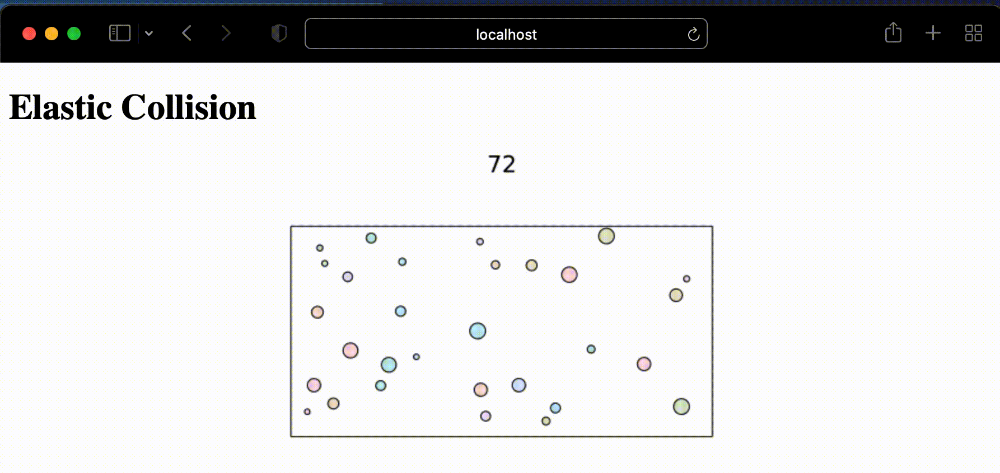

# ElasticCollision.jl

- Genie app utilize [GeometryObjects.jl](https://github.com/AtelierArith/GeometryObjects.jl)



# Usage

## Prerequisite

1. Install Julia 1.10 or newer from [here](https://julialang.org/downloads/)
2. git clone this project:

```console
$ cd /path/to/your/workspace
$ git clone --recursive https://github.com/AtelierArith/ElasticCollision.jl.git
```

3. Set up the app and the pinned GeometryObjects submodule:

```console
$ cd /path/to/ElasticCollision.jl
$ julia --project=. setup.jl
```

## Running Julia server

```
$ cd /path/to/ElasticCollision.jl
$ julia --project=. setup.jl
$ ./bin/server
```

then open your web browser and go to `http://localhost:8000/`

### Tips

You can adjust the number of particles and the length of time gif via `http://localhost:8000/?maxT=300&num_particles=60`

`setup.jl` registers the checked-out `lib/` submodule as a local package and
installs its dependencies. If you cloned without `--recursive`, first run
`git submodule update --init --recursive`. Run setup again after updating the
submodule. No packages are installed by the server at startup.

The server script can also be called by its absolute path from another directory.
Use `PORT=8001 ./bin/server` to select a different port.

## Startup regression test

After setup, run `python3 test/server_smoke.py`. It starts the real server from
a temporary working directory, checks the static-file route and requests a
one-frame GIF, then stops the server. CI runs this check on Julia 1.10, LTS,
and stable. Choose an unused port via `ELASTIC_TEST_PORT` if needed.
